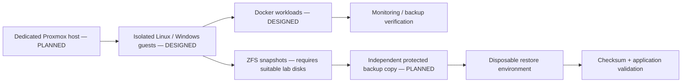

# RECOVEROPS | Virtualization, Monitoring & Disaster Recovery Platform

**Author:** Pratik Aeraple
**Public project portal:** <https://recoverops.brutehack.com>
**Repository status:** public portfolio project
**Proxmox deployment:** PLANNED / REQUIRES DEDICATED VIRTUALIZATION HOST
**BruteHost production backups:** DEFERRED / NOT IMPLEMENTED

## Problem

A backup job is not a recovery capability until a separate copy can be read, restored into an isolated destination and verified. RECOVEROPS documents a future virtualization/recovery architecture and provides safe fixture-only automation for integrity, service recovery and restore validation.

## Objectives

- Define a Proxmox, Linux/Windows guest, Docker, ZFS, monitoring and independent-copy design.
- Generate and verify a cryptographic manifest for disposable files.
- Demonstrate configuration/data loss, restore into a new destination, deliberate corruption detection and loopback service recovery.
- Explain how RPO and RTO should be measured without inventing achieved values.
- Keep all actual BruteHost production backup claims deferred.

## Architecture



Full platform and data-protection architecture is in [`docs/architecture.md`](docs/architecture.md).

## Implemented and lab-validated

- `src/recoverops.py`: bounded fixture manifest generation, SHA-256 verification, safe-path enforcement, restore to a new destination, and an isolated loopback service failure/recovery drill.
- `scripts/collect-health.sh`: read-only local uptime/load/memory/root-space and generic service state collection; no network transmission.
- Tests reject corrupted/missing data, absolute/traversal/symlink paths, and overwrite of an existing restore destination.
- `python3 src/recoverops.py demo` creates a unique OS temporary workspace, copies fixture-only data, simulates loss, restores and verifies bytes, detects a corrupt copy, stops a child HTTP process, detects the outage and recovers it. Temporary fixture data is removed automatically.

These outcomes are **LAB VALIDATED** for the disposable fixture only. They are not a production backup, achieved RPO/RTO, Proxmox restore or ZFS recovery result.

## Designed and external-platform work

- **DESIGNED:** Proxmox host, isolated Linux and Windows Server VMs, Docker workloads, ZFS snapshots, independent encrypted/versioned backup host, retention, verification, monitoring and restore network.
- **PLANNED / REQUIRES DEDICATED VIRTUALIZATION HOST:** Proxmox. It is not installed on BruteHost.
- **NOT IMPLEMENTED:** production ZFS pool and BruteHost backup system. No disks, filesystems, mounts or production datasets were changed.
- A future retention example in architecture docs is design guidance only. No retention job is active.

## Repository map

```text
docs/              architecture, operations, recovery runbook, lab evidence
scripts/           read-only host health collector
src/               fixture recovery automation and static portal server
tests/             recovery safety and portal HTTP tests
web/               public portal, diagrams and metadata
```

## Run and test

Requires Python 3.11+ and Node 24.22.1 (no third-party package required for the portal).

```bash
npm run check
npm test
python3 -m unittest discover -s tests -v
python3 src/recoverops.py demo
bash scripts/collect-health.sh
```

The health collector reads only local system values. The recovery demo refuses production paths by construction: it uses a fresh `TemporaryDirectory` and does not accept a target directory argument.

## Security and recovery boundaries

No backup credentials, encryption key, customer data, production manifest or host path is stored in this repository. Restore refuses overwrite and unsafe path traversal; symlinks are rejected. Do not run destructive recovery against BruteHack, Portfolio, Portainer, Caddy, cloudflared, Kuma, Netdata, the server portal, host OS or owner data. Do not initialize a ZFS pool or change BruteHost storage as part of this project.

## Troubleshooting

- A digest mismatch is a failed integrity check; do not overwrite the expected manifest or declare recovery successful.
- A missing file is distinct from a checksum mismatch and must be reported separately.
- A loopback service drill that cannot bind or restart should fail; it must not choose a production service as a substitute.
- Monitoring evidence detects observed states but does not prove recoverability; restore verification is a separate gate.
- Never translate the local demonstration's elapsed time into a business RTO.

## Lessons and future work

Integrity, availability and recoverability are different properties. Independent copies protect against source loss; isolated restore tests protect against unreadable or incomplete copies. Actual objectives must be set with workload owners, tested against suitable hardware, and measured from real incident and recovery timestamps.

## Author

Pratik Aeraple
