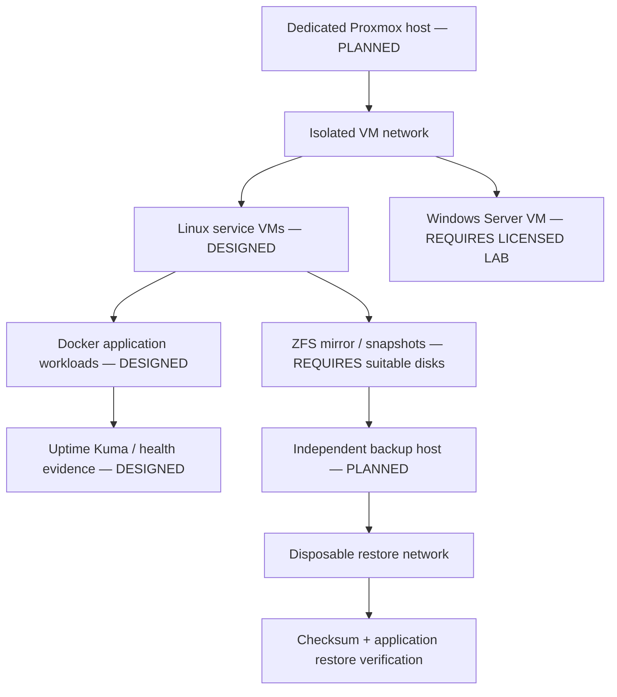

# RECOVEROPS recovery architecture

**Status: DESIGNED.** This is a reference architecture, not a live Proxmox/ZFS deployment. BruteHost production backups remain **DEFERRED / NOT IMPLEMENTED**.

## Platform layout

Do not install Proxmox on BruteHost as part of this project. No disks are initialized, no pool is created and no production data is used. A future lab should use a dedicated virtualization host, separate test storage, out-of-band console access and a second independent backup destination.

## Data protection design

1. Classify data by owner, confidentiality, recovery priority and application consistency needs.
2. Snapshot only after application-aware quiescence where required; snapshots are not an independent backup.
3. Copy encrypted, versioned data to a separate host/account with separate credentials and restricted deletion rights.
4. Apply a written retention schedule only after storage, regulatory and cost requirements are known. Example policy for a future lab: daily 14, weekly 8, monthly 12; **DESIGNED example, not active retention**.
5. Verify object readability and manifests on each backup run. Periodically restore into an isolated clean destination and validate checksums plus application-level behavior.
6. Keep at least one recovery copy offline or protected from source credentials. Monitor backup age, verification failures, destination capacity and restore test age.

## RPO/RTO method (no achieved targets claimed)

- **RPO** is the elapsed time between the last known-good, independently verified recovery point and the incident cut-off. Measure from timestamps in real manifests; never infer from snapshot frequency alone.
- **RTO** begins at declared service-impact time and ends only after a restore is verified and service owner acceptance is recorded. Include detection, decision, restore, validation and communication time.
- Set targets only after workload owners and business impact are known. The fixture lab reports its own local elapsed time, not production RTO/RPO.

## Monitoring and operations

Collect service state, backup job result, last successful independent copy, verification result, destination headroom and restore-test age. Alert on a failed or stale copy and on recovery validation failure; deduplicate by job/incident ID and send a recovery notice only after verification passes. A monitoring green state is not proof that a backup can be restored.

## Platform status

- **Proxmox deployment: PLANNED / REQUIRES DEDICATED VIRTUALIZATION HOST.**
- Windows Server guest: **DESIGNED / REQUIRES LICENSED LAB**.
- Production ZFS: **NOT IMPLEMENTED**; no pool or disk changes were made.
- BruteHost backups: **DEFERRED / NOT IMPLEMENTED**. RECOVEROPS disposable fixture exercises are not BruteHost backups.
